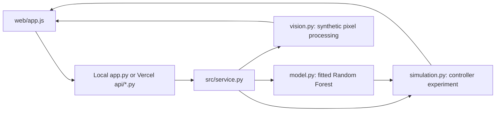

# Understand and manage your code

## Start with this mental model

The browser is the display; Python is the calculation engine. The browser requests JSON data, then draws the dashboard. The Random Forest lives in Python and predicts demand. A separate controller chooses signals. The camera panel demonstrates segmentation independently.



## A reading order that makes the project easier

1. **src/model.py**: `dataset()` creates examples; `train()` fits the 60-tree forest and measures held-out errors.
2. **src/simulation.py**: `arrivals_for()` generates a common arrival array; `simulate()` executes one controller; `compare()` runs all three policies.
3. **src/vision.py**: `scene()` creates pixels; `detect()` counts components from those pixels; `analyze()` returns a PNG and boxes.
4. **src/service.py**: `response_for()` validates requests and calls the right calculation. `model_bundle()` reuses the trained forest within a process.
5. **app.py / api/*.py**: HTTP adapters. The local adapter serves files too; Vercel serves `web/` statically and calls one Python function per API route.
6. **web/app.js**: requests results, draws the intersection/chart/camera, updates metrics, and runs presentation navigation.
7. **web/style.css**: typography, colors, layouts, and responsive rules. **web/index.html** defines the page structure.

## Trace one click: Run experiment

1. `run()` in web/app.js reads scenario and seed.
2. The browser requests `/api/run?scenario=rush&seed=42`.
3. The handler passes the request to `response_for('run', query)`.
4. `model_bundle()` trains on the first model request in that process; later requests reuse it.
5. `compare()` creates identical traffic for fixed, queue-only, and ML-assisted policies.
6. `simulate()` predicts arrivals every ten seconds and updates queues every second.
7. Python returns histories and aggregate metrics as JSON.
8. `populate()` shows full-run metrics; `render()` draws the selected playback moment.

The whole experiment is computed before playback. Playback is a visualization of its recorded history, not live physical traffic.

## Where to make changes

| I want to change... | Edit... | Then verify... |
|---|---|---|
| Colors and layout | web/style.css | Open wide and narrow browser layouts |
| Page text | web/index.html | Check labels and claims still match code |
| Slides | slides array in web/app.js | Click through presentation mode |
| Forest parameters | train() in src/model.py | Run tests, verify_model.py and evaluate.py |
| Traffic rates | SCENARIOS in src/simulation.py | Re-run evaluation and update report numbers |
| Controller weights/timings | simulate() in src/simulation.py | Run tests and compare all three policies |
| Camera colors or regions | src/vision.py | Update detector assumptions and CV tests |
| API validation | src/service.py | Run tests/test_api.py through unittest discovery |

Do not manually change metric JSON files to improve results. Regenerate them from the actual code. Report both improvements and regressions.

## Training versus inference

Training calls `.fit()` to build trees from labeled synthetic examples. Inference calls `.predict()` on recent traffic counts. Signals are selected by explicit rules, not by training a policy. The same actual Python model is used locally and on Vercel. A new serverless process can incur a brief first-request training delay; warm requests reuse its forest.

## Everyday GitHub workflow

Git records code history. GitHub hosts the repository. Vercel hosts the running app. GitHub Actions checks the code; it does not host the website.

```bash
git pull
git switch -c codex/my-change
# Make a small change.
python3 -m unittest discover -s tests -v
python3 verify_model.py
node --check web/app.js
git add <files-you-changed>
git commit -m "Describe what changed"
git push -u origin codex/my-change
```

Open a pull request on GitHub to compare the changes before merging. Once Vercel's Git integration is connected, main-branch pushes normally trigger a production deployment and other branches create previews. Check that both tests and the Vercel build pass.

## What belongs in the repository?

Source code, requirements, tests, reproducible results, documentation, and the final PDFs. Temporary renders, Python caches, virtual environments, ZIP exports, credentials, and Vercel local state are ignored. Do not commit access tokens or `.env` files.

## Honest scope

Traffic and camera frames are synthetic. The CV demo is separate from control. This is not reinforcement learning, real CCTV detection, or a road-safe signal controller. A working model is evidence of implementation, not validation on real roads.

## Try the Model tab

Enter three integer counts (newest first) and submit. The browser calls `/api/predict?counts=6,6,6`; `src/service.py` validates them and calls the same fitted forest used by the simulator. The response includes the expected count, rounded count, model metadata, and an out-of-training-range flag. Example inputs can be submitted directly.

`web/async.js` centralizes request retries and camera freshness. A temporary network error is retried once; if the local server is unreachable, the interface explains how to restart it. Keep `python3 app.py` running while using localhost. A localhost URL only reaches the device running that browser; use the hosted URL on another device.
